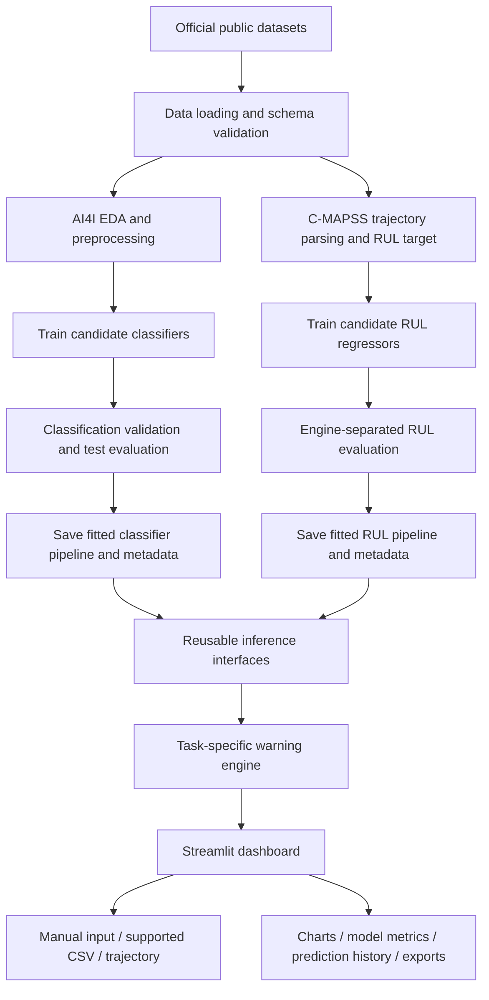

# System Architecture

## 1. Overview

The system is a local-first, modular Python application. Jupyter notebooks are used for research and training; reusable validation, inference and alert code lives in `src/`; Streamlit imports those modules and displays their outputs. The MVP stores files locally and does not connect to physical industrial hardware.

There are two separate ML pipelines because their source data and prediction targets differ:

- **Path A — AI4I failure-risk classification:** estimate the labelled failure outcome for a supported operating record.
- **Path B — NASA C-MAPSS RUL regression:** estimate remaining operating cycles from an engine trajectory.

The UI must label the task and dataset for every result. Do not describe the two models as one validated model for the same physical machine.

## 2. High-level architecture



## 3. Component responsibilities

### `data/` — raw and processed data

```text
data/
  raw/
    ai4i2020.csv
    NASA_CMAPSS/
  processed/
```

- Preserve original downloads in `raw/` and write transformed data separately.
- Document source links and expected schemas.
- Do not modify original datasets in place.
- Raw data and large generated outputs should normally be excluded from Git.

### `notebooks/` — research and explanation

```text
notebooks/
  01_data_exploration.ipynb
  02_failure_classification.ipynb
  03_rul_forecasting.ipynb
```

- Inspect distributions, label imbalance, missingness and feature relationships.
- Document approved features, target definitions and split strategies.
- Train and compare candidate models.
- Produce metrics and plots suitable for the report.
- After validating the workflow, move reusable logic into `src/` so the dashboard does not depend on executing notebooks.

### `src/data_validation.py`

- Validate required columns and supported schema for each task.
- Check types, empty files, missing values, infinite values and invalid values.
- Keep AI4I and C-MAPSS validation rules separate.
- Return actionable errors for the UI; do not silently guess unsupported schemas.

### `src/preprocessing.py`

- Define approved feature lists and transformations.
- Use fitted scikit-learn pipelines for encoding/scaling/imputation where needed.
- Keep feature order and transformations consistent between training and inference.
- Fit any learned transformation on training data only.
- Exclude IDs and target-derived failure-mode flags from AI4I predictors.
- Do not calculate features using future trajectory information unavailable at prediction time.

### `src/train_classifier.py` and `src/prediction.py`

Training process:

1. Load and validate AI4I.
2. Define `Machine failure` as target.
3. Use only approved operating features; exclude `UDI`, `Product ID`, `TWF`, `HDF`, `PWF`, `OSF`, `RNF` from `X`.
4. Create reproducible stratified train/validation/test splits.
5. Fit a DummyClassifier baseline and candidate pipelines.
6. Compare recall, precision, F1, PR-AUC / average precision and confusion matrices.
7. Select model and any warning threshold using validation data only.
8. Evaluate final chosen pipeline on untouched test data.
9. Save the fitted pipeline, feature schema, selected threshold and metric metadata.

Inference process:

1. Validate the incoming record or CSV.
2. Apply the fitted pipeline; never refit transforms on upload data.
3. Return the predicted class and a documented score/probability when supported.
4. Return task, dataset, model identifier and explanatory caveat.

AI4I results describe the dataset's row-level failure label. They do not forecast a defined future time horizon.

### `src/train_rul.py` and `src/rul_prediction.py`

Training process:

1. Load the documented C-MAPSS subset, initially FD001.
2. Parse engine ID, operating cycle, settings and sensor columns.
3. Sort each engine trajectory by cycle.
4. Derive RUL per training row from terminal training cycle minus current cycle, following the documented target convention.
5. Split by engine ID for train/validation to avoid engine leakage.
6. Train a simple regression baseline and a tree-based candidate.
7. Evaluate MAE/RMSE in cycles and inspect residuals/actual-vs-predicted plots.
8. Use the official test trajectory and terminal RUL labels for final test scoring where applicable.
9. Save the fitted model, feature schema, feature-window convention, target convention and metrics.

The prediction input must match the training feature definition. If features depend on rolling windows, the app must require enough trajectory history to derive them. The model must not use engine ID or future observations as predictive features.

### `src/alerts.py` — warning engine

Inputs:
- classifier score/label and its selected threshold;
- optional RUL estimate and cycle threshold;
- data-quality and model-availability state.

Outputs:
- task-specific warning category and message;
- reason that threshold was met;
- dataset/task/model identifier;
- application timestamp;
- optional advisory to follow approved inspection procedures.

Rules:
- Classification and RUL thresholds are separate configuration values.
- Thresholds and rationale must be documented.
- Warnings are advisory, never control commands.
- Do not label a below-threshold record as guaranteed healthy.
- Do not produce predictions when required data/model artifacts are missing or invalid.

### `app/` — Streamlit UI

Suggested modules:

```text
app/
  streamlit_app.py
  pages/                  # use if compatible with chosen Streamlit navigation pattern
  components/             # reusable cards, charts, status and empty states
```

Pages: Overview, Failure Risk, Sensor Analytics, RUL Forecast, Model Evaluation, Alerts & History.

The UI should use the visual rules in `design.md`. An empty state is required if a dataset/model/metric is not ready. Demo examples may be provided but must be labelled; no fabricated predictions or metrics.

### `reports/` and `models/`

- `models/`: trusted artifacts from the training workflow and metadata.
- `reports/metrics/`: machine-readable metrics and experiment settings.
- `reports/figures/`: plots used by the notebook/report/dashboard.
- Keep model metadata tied to the dataset, selected features, split method and dependency/model version.

## 4. Recommended repository layout

```text
industrial-machine-failure-early-warning/
├── prd.md
├── techstack.md
├── architecture.md
├── design.md
├── phasewiseprompt.md
├── README.md
├── requirements.txt
├── .gitignore
├── data/
│   ├── raw/
│   └── processed/
├── notebooks/
│   ├── 01_data_exploration.ipynb
│   ├── 02_failure_classification.ipynb
│   └── 03_rul_forecasting.ipynb
├── src/
│   ├── __init__.py
│   ├── data_validation.py
│   ├── preprocessing.py
│   ├── train_classifier.py
│   ├── prediction.py
│   ├── train_rul.py
│   ├── rul_prediction.py
│   └── alerts.py
├── app/
│   ├── streamlit_app.py
│   ├── pages/              # optional based on navigation implementation
│   └── components/
├── models/
│   └── metadata/
├── reports/
│   ├── metrics/
│   └── figures/
└── tests/
    ├── test_data_validation.py
    ├── test_predictions.py
    ├── test_rul.py
    └── test_alerts.py
```

The implementation may adjust this structure with a documented reason, but should retain clear boundaries between model training, prediction logic, warning rules and interface code.

## 5. Data flow contracts

### AI4I input contract

Required columns for inference:

- `Type`
- `Air temperature [K]`
- `Process temperature [K]`
- `Rotational speed [rpm]`
- `Torque [Nm]`
- `Tool wear [min]`

Example response shape (schema only; values shown are placeholders, not a prediction):

```json
{
  "task": "failure_risk_classification",
  "dataset_context": "AI4I 2020",
  "predicted_label": null,
  "model_score": null,
  "threshold": null,
  "alert_level": "UNAVAILABLE",
  "message": "Model output requires a trained artifact and valid input."
}
```

### RUL response contract

```json
{
  "task": "remaining_useful_life_regression",
  "dataset_context": "NASA C-MAPSS FD001",
  "predicted_remaining_cycles": null,
  "unit": "operating_cycles",
  "warning_threshold_cycles": null,
  "alert_level": "UNAVAILABLE",
  "message": "RUL requires a supported trajectory input and trained model."
}
```

These examples define structure only. They must not be shown as actual prediction records with invented scores.

## 6. Verification strategy

### Unit tests

- Missing required columns are rejected with readable messages.
- Identifiers and leakage-prone target-derived fields do not enter the classifier feature list.
- Preprocessing preserves the trained feature contract.
- Invalid values and empty CSVs are rejected.
- Warning rules handle below/at/above-threshold cases correctly.
- Classifier and RUL thresholds cannot accidentally affect each other.
- RUL features are derived using only information available at the prediction cycle.

### Integration tests

- Load the saved classifier and predict one valid record.
- Predict a valid batch and export results.
- Load the saved RUL artifact and predict a valid trajectory input.
- Fail gracefully if an artifact or metric file is missing.
- Confirm every dashboard page renders without an exception.
- Confirm results display the correct task, units and dataset context.

### ML checks

- Inspect target balance and split composition.
- Check for data leakage and preprocessing fitted outside the training set.
- Confirm validation/test engines are distinct from training engines in RUL evaluation.
- Record random seeds, engine split identifiers, feature list and metrics.

## 7. Operational limitations

- This is a local software prototype using public synthetic/simulated data.
- No physical machine or live telemetry is connected in MVP.
- AI4I classification is not a future-window prediction.
- C-MAPSS RUL results are specific to the documented model/data setup until validated against relevant real equipment.
- Dashboard warnings must not be used as the sole basis for safety-critical maintenance decisions.

## 8. Optional future extensions (not MVP)

Consider only after the core project is tested: FastAPI inference API, persistent database, user authentication, continuous telemetry ingestion, MQTT/OPC-UA gateway, data/model drift monitoring, cloud hosting or sequence deep-learning models.
