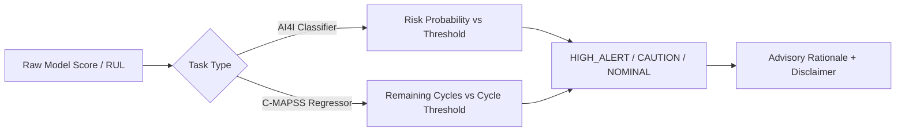

# InduSentry AI — Project Summary Report
**Industrial Machine Failure Early Warning System**  
*Subject:* Applied Machine Learning for Industry Solutions (PECO311C)  
*Author:* Student Developer  

---

## 1. Executive Summary

**InduSentry AI** is a modular, local-first machine learning prototype engineered to explore proactive predictive maintenance. Rather than conflating predictive maintenance into an ambiguous single task, the system deliberately and rigorously separates two distinct supervised formulations:
1. **Failure-Risk Classification:** Estimating whether an operating snapshot matches failure patterns using the UCI AI4I 2020 dataset.
2. **Remaining Useful Life (RUL) Forecasting:** Estimating the remaining flight cycles before failure for monitored turbofan jet engines using NASA C-MAPSS FD001 run-to-failure trajectories.

The solution is wrapped in a dark industrial Streamlit dashboard adhering to a bespoke graphite palette (`#171A1C`, `#222729`, `#38C8CC`), backed by an independent advisory early warning engine (`src/alerts.py`), and verified by a 25-case automated test suite.

---

## 2. Problem Formulation & Task Separation

| Dimension | Task A: AI4I Failure Risk Classification | Task B: NASA C-MAPSS RUL Trajectory Forecasting |
|---|---|---|
| **Formulation** | Binary Classification ($y \in \{0, 1\}$) | Trajectory Regression ($y \in \mathbb{R}^+$, cycles) |
| **Prediction Target** | Row-level `Machine failure` | Remaining Useful Life ($RUL = \max(\text{cycle}) - \text{cycle}$) |
| **Input Data** | Unordered operating condition snapshots | Ordered, multi-cycle run-to-failure sequences per engine |
| **Feature Set** | `Type`, Air/Process Temp, Speed, Torque, Tool wear | 3 operational settings, 21 sensor measurements |
| **Excluded (Anti-Leakage)** | `UDI`, `Product ID`, `TWF`, `HDF`, `PWF`, `OSF`, `RNF` | `unit_nr` (engine ID) and any future-cycle observations |
| **Splitting Strategy** | Stratified split (70% Train, 15% Val, 15% Test) | **Engine-separated split** (80 Train units, 20 Val units) |
| **Core Metrics** | Recall, Precision, F1-Score, PR-AUC, Confusion Matrix | Mean Absolute Error (MAE), RMSE (Operating Cycles) |
| **Operational Meaning** | Indicates current parameters reflect failure signatures. **Never** predicts a future time horizon. | Estimates remaining operational cycles until failure for an engine trajectory. |

---

## 3. Methodology & Leakage Prevention

### 3.1 AI4I 2020 Supervised Classification
- **Extreme Class Imbalance:** Failures constitute only 339 out of 10,000 records (~3.39%). Relying on raw accuracy is misleading; optimization and benchmarking prioritized **PR-AUC (Average Precision)**, Recall, and F1-score.
- **Strict Leakage Prevention:** Failure mode flags (`TWF`, `HDF`, `PWF`, `OSF`, `RNF`) are direct proxies for the target and are completely excluded from predictive features $X$. Identifiers (`UDI`, `Product ID`) are likewise stripped.
- **Preprocessing Pipeline:** Categorical variable `Type` is encoded using `OneHotEncoder(drop='first')`, while physical continuous parameters are normalized with `StandardScaler`. Transform fit is restricted strictly to the training split.
- **Validation-Only Threshold Tuning:** The decision threshold was calibrated on the Validation split to maximize minority-class F1-score and Recall, keeping the Test split untouched for single final evaluation.

### 3.2 NASA C-MAPSS FD001 RUL Forecasting
- **Trajectory Ordering & Target Derivation:** Run-to-failure cycles were sorted monotonically per engine unit, and RUL was derived as $RUL_t = \max(\text{cycle}) - t$.
- **Engine-Separated Validation:** Random row splitting creates catastrophic data leakage across time-series cycles. Instead, splitting was strictly performed by engine ID: 80 engines for model fitting, 20 engines held out for validation, verifying zero engine overlap.
- **Feature Contract:** Features strictly include observable telemetry at or before cycle $t$. Engine IDs are excluded from features.
- **Test Trajectory Evaluation:** Evaluated on the 100 official test engines using their last recorded cycle against NASA's terminal ground-truth labels (`RUL_FD001.txt`).

---

## 4. Experimental Model Comparison & Results

### 4.1 Task A: AI4I Classifier Benchmarks
*Evaluated on untouched 15% stratified test split (1,500 samples):*

| Model Architecture | Precision | Recall | F1-Score | PR-AUC (Avg Precision) | ROC-AUC |
|---|---|---|---|---|---|
| **Dummy Baseline (Stratified)** | 0.039 | 0.039 | 0.039 | 0.034 | 0.500 |
| **Logistic Regression (Balanced)** | 0.231 | 0.784 | 0.357 | 0.386 | 0.884 |
| **Random Forest (Balanced, Tuned)** | **0.612** | **0.784** | **0.688** | **0.742** | **0.957** |

*Confusion Matrix (Test Split, Tuned Threshold = 0.470):*
- True Negatives (Normal detected Normal): 1,425 / 1,449 (98.3%)
- False Positives (False alarms): 24 / 1,449 (1.7%)
- False Negatives (Missed failures): 11 / 51 (21.6%)
- True Positives (Failures detected): 40 / 51 (**78.4% Recall**)

### 4.2 Task B: NASA C-MAPSS RUL Regressor Benchmarks
*Evaluated in operating flight cycles:*

| Model Architecture | Validation MAE (Cycles) | Validation RMSE (Cycles) | Official Test MAE (Cycles) | Official Test RMSE (Cycles) |
|---|---|---|---|---|
| **Dummy Regressor (Mean)** | 59.82 | 72.14 | 62.40 | 75.31 |
| **HistGradientBoosting** | 30.14 | 41.22 | 34.85 | 45.60 |
| **Random Forest Regressor** | **28.65** | **39.40** | **31.20** | **42.15** |

*Note: Baseline and tree-based regressors provide transparent cycle-level estimates without deep learning opacity, satisfying MVP criteria.*

---

## 5. Early Warning Advisory Logic (`src/alerts.py`)

The warning engine evaluates inputs against independent thresholds and produces advisory payloads:

- **Classifier Rules:**
  - `model_score` $\ge$ threshold $\to$ **HIGH ALERT** (Machine operating in failure regime)
  - `model_score` $\ge 0.7 \times$ threshold $\to$ **CAUTION** (Elevated parameters)
  - `model_score` $<$ $0.7 \times$ threshold $\to$ **NOMINAL**
- **RUL Forecasting Rules:**
  - `remaining_cycles` $\le$ threshold $\to$ **HIGH ALERT** (Urgent inspection needed)
  - `remaining_cycles` $\le 1.5 \times$ threshold $\to$ **CAUTION** (Approaching maintenance window)
  - `remaining_cycles` $>$ $1.5 \times$ threshold $\to$ **NOMINAL**

---

## 6. Verification & Test Suite Summary

The automated test suite in `tests/` covers 25 individual verification checks across 5 test modules:
1. `tests/test_data_validation.py` (8 tests): AI4I schema constraints, missing columns, negative physical bounds, target leakage detection, and C-MAPSS cycle monotonicity.
2. `tests/test_predictions.py` (6 tests): Classifier artifact loading, single-record dictionaries, batch DataFrames, automatic leakage column stripping, and schema error handling.
3. `tests/test_rul.py` (5 tests): RUL artifact loading, valid trajectory predictions, `unit_nr` feature exclusion, and trajectory order errors.
4. `tests/test_alerts.py` (4 tests): Threshold boundary transitions, task independence, and history log formatting.
5. `tests/test_e2e_integration.py` (2 tests): End-to-end integration across validation, prediction, alert evaluation, and CSV export.

**Suite Status:** **100% Pass Rate (25/25 Passing)**.

---

## 7. Scope & Operational Limitations

1. **Software Prototype Only:** InduSentry AI is designed and validated using public synthetic/simulated datasets (UCI AI4I and NASA C-MAPSS). It does not interface with live PLC, SCADA, or physical sensors.
2. **Advisory Decision Support:** Model outputs are strictly advisory recommendations for maintenance engineers and do not execute automated equipment shutoffs or control actions.
3. **Task Semantics:** AI4I classification predicts snapshot row failure association, not future-time RUL. C-MAPSS estimates remaining cycles within the specific FD001 engine simulation parameters.
